# Lesson 1: Monorepos, Turborepo, and AI coding

**Time:** about 10–15 minutes
**Goal:** understand how this repository is organized, why, and why that organization makes AI coding agents more effective.

By the end of this lesson you should be able to answer three questions:

1. What is a monorepo, and how is it different from a polyrepo?
2. What does Turborepo add on top of a plain monorepo, and why did we pick it?
3. Why does this setup help when an AI agent builds features for you?

---

## 1. What is a monorepo?

A **monorepo** is a single Git repository that contains several projects that are developed together. In this workshop, the frontend, the backend, the API contract and the database schema all live in one repository.

The alternative is a **polyrepo**: one repository per project. The frontend lives in one repo, the backend in another, and shared code is published as a versioned package that the other repos install.

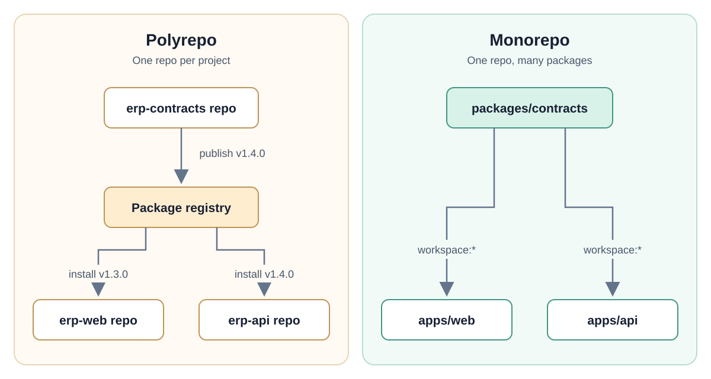

In the polyrepo picture, the web app and the API can end up on different versions of the shared contract. Every change to shared code needs a publish step, then a version bump in each consumer. In the monorepo picture, both apps always use the current code on disk.

### A monorepo is not a monolith

A monolith is one application deployed as one unit. A monorepo is only about where the source code lives. `apps/web` and `apps/api` are still two separate applications with their own dependencies, builds and deployments. They just share a repository.

### What this repository looks like

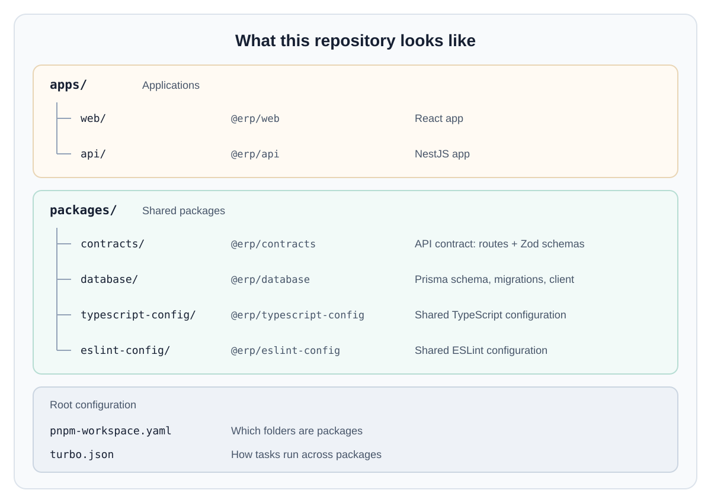

Two pieces of plain configuration turn this folder into a monorepo.

**pnpm workspaces** tell the package manager that every folder under `apps/` and `packages/` is its own package:

```yaml
# pnpm-workspace.yaml
packages:
  - apps/*
  - packages/*
```

A package then depends on a sibling package by name, with `workspace:*` as the version. That means "use the copy in this repository". From `apps/web/package.json`:

```json
{
  "dependencies": {
    "@erp/contracts": "workspace:*"
  }
}
```

Nothing is published and nothing gets out of sync. pnpm links the folders together.

### How the packages depend on each other

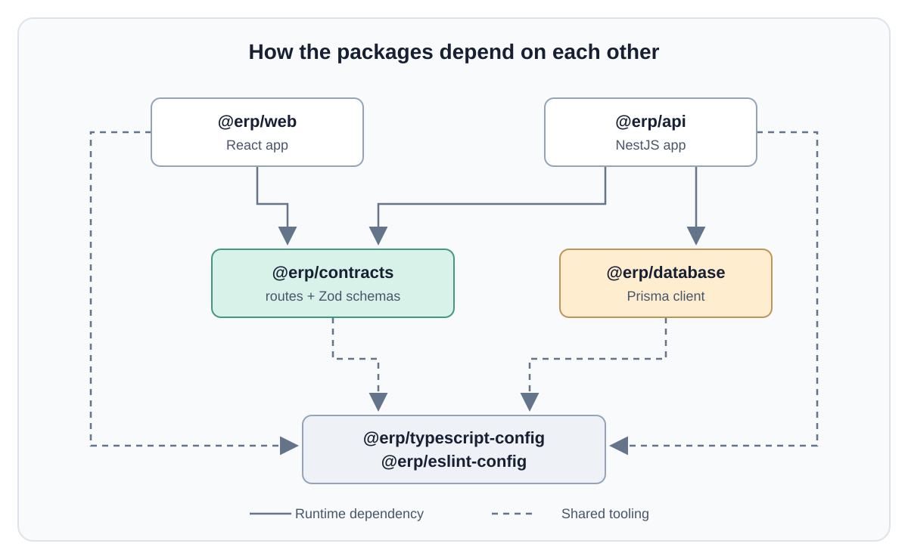

Solid arrows are runtime dependencies. Dashed arrows are shared tooling configuration.

The most important box is `@erp/contracts`. It describes every API endpoint once: method, path, input and output. The API implements it, and the web app calls it through a typed client generated from it. Both apps depend on that one package, so they cannot disagree about what the API looks like.

### Why teams choose a monorepo


### What it costs

Monorepos have real downsides, and it's worth knowing them:


The first three are tooling problems, and they are exactly what Turborepo solves.

---

## 2. Why Turborepo?

pnpm workspaces link the packages together. They don't know that `build` in `apps/web` must wait for `build` in `packages/contracts`, and they don't remember that a package was already built a minute ago from the same files.

**Turborepo** is a task runner for JavaScript and TypeScript monorepos. It adds two things on top of the workspace.

### 2.1 A task graph

You describe how tasks relate in `turbo.json`. This is the core of ours:

```json
{
  "tasks": {
    "build": {
      "dependsOn": ["^build"],
      "outputs": ["dist/**", "target/**"]
    },
    "test": {
      "dependsOn": ["^build"]
    }
  }
}
```

`"^build"` means: before running this task in a package, run `build` in every package it depends on. The `^` stands for "my dependencies". So before `web` builds, `contracts` builds first, and `@erp/contracts` regenerates its TypeScript client from the committed OpenAPI spec as part of that build.

From these rules and the package graph above, Turborepo works out the order. It runs independent tasks in parallel:

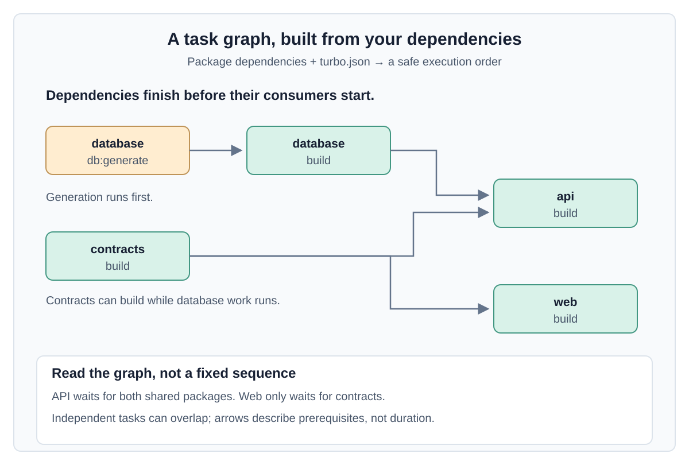

`contracts` builds and the web app starts as soon as `contracts` is done. You never write this order by hand. Add a new package with the right dependencies, and it slots into the graph.

### 2.2 Caching

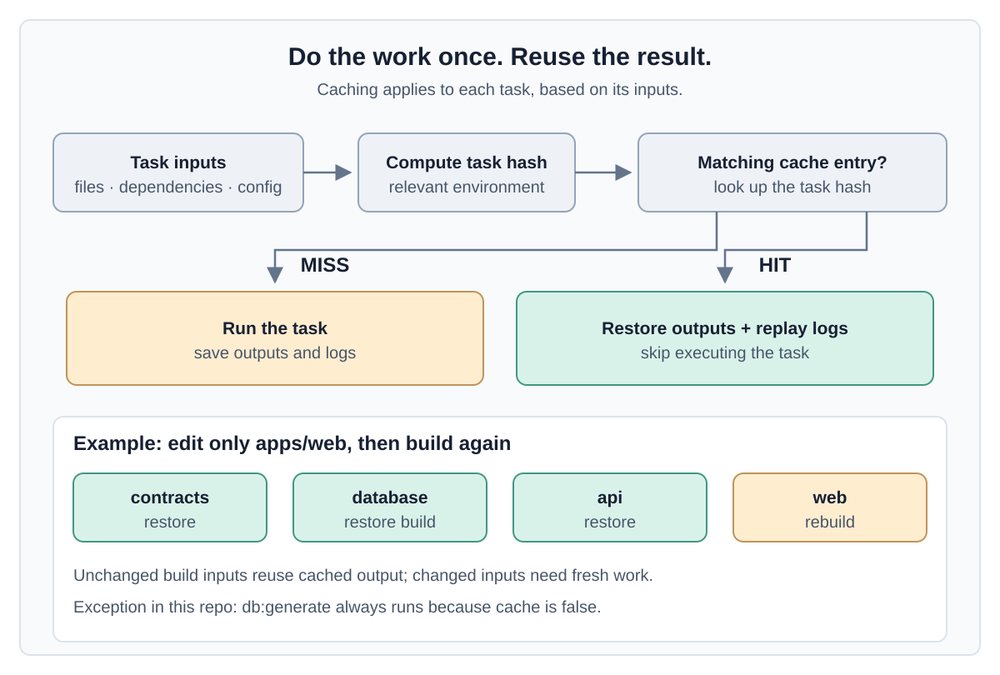

Before running a task, Turborepo computes a hash of everything that affects it: the package's files, its dependencies' hashes, the task configuration, and the relevant environment. If it has seen that hash before, it doesn't run the task. It restores the saved output (`dist/**`) and replays the logs.

On this repo, a second `pnpm turbo run build` with no changes reports most tasks as cached and finishes in under a second. The `@erp/contracts` build regenerates its client from the committed OpenAPI spec before bundling, so a spec change busts its cache and everything downstream of it.

Change one file in `apps/web` and only `web`'s tasks run again. Everything else comes from the cache. The cache can also be shared between machines and CI (remote caching), but we don't need that for the workshop.

### 2.3 Running a subset

`--filter` limits a command to the packages you care about:

```bash
pnpm turbo run test --filter=@erp/web
```

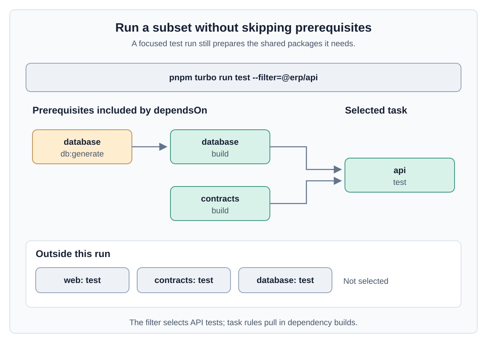

Turborepo still builds whatever `@erp/web` depends on first, so the result is correct, not just fast.

### Why Turborepo and not something else?


We chose Turborepo because it is a **thin layer**:

- Every package keeps its normal scripts. `vite build` and `prettier` run exactly as their docs describe, and the Java API builds with `mvn package`.
- All the monorepo-specific configuration is one file of about 40 lines.
- If you removed Turborepo tomorrow, every package would still build on its own.

That makes it easy to learn in a workshop, and easy for an AI agent to understand, which matters for the next section.

---

## 3. Why this setup helps AI coding

An AI coding agent works in a loop: read the code, make a change, run something to check it, read the result, fix, repeat. It does well when it can **see everything relevant** and **get fast, clear feedback**. A monorepo with a shared contract and a cached task runner gives it both.

### 3.1 The whole feature is in one place

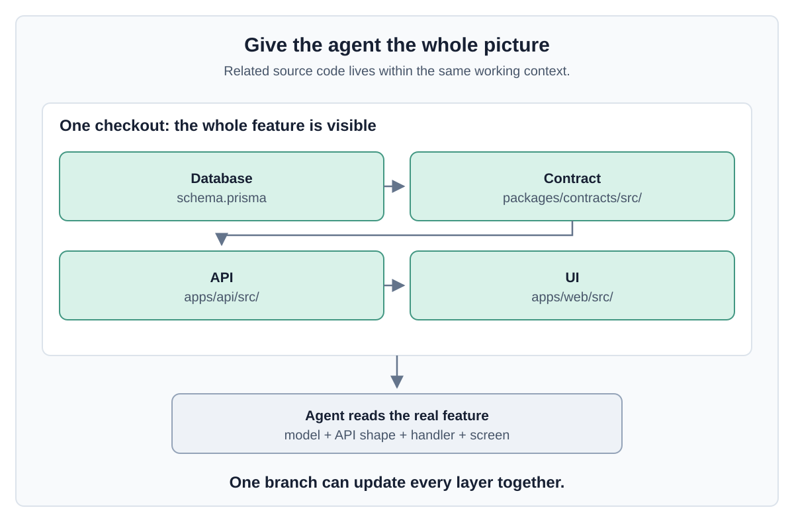

To build a real feature, an agent needs to know the database model, the API shape, the handler and the screen that calls it. In a polyrepo, half of that is in another repository the agent can't see, so it guesses. Here, one checkout contains:

- `apps/api/src/main/resources/db/migration/`: the data model, as Flyway migrations
- `packages/contracts/openapi.json`: the exact API shape
- `apps/api/src/main/java/`: the controllers and entities
- `apps/web/src/`: the UI

The agent reads the real contract instead of guessing at it.

### 3.2 Vertical slices: build end to end, from the first phase

There are two ways to split a feature into phases.

**Horizontal phases** build one layer at a time. **Vertical slices** cut through every layer in every phase, delivering a thin piece that works end to end:

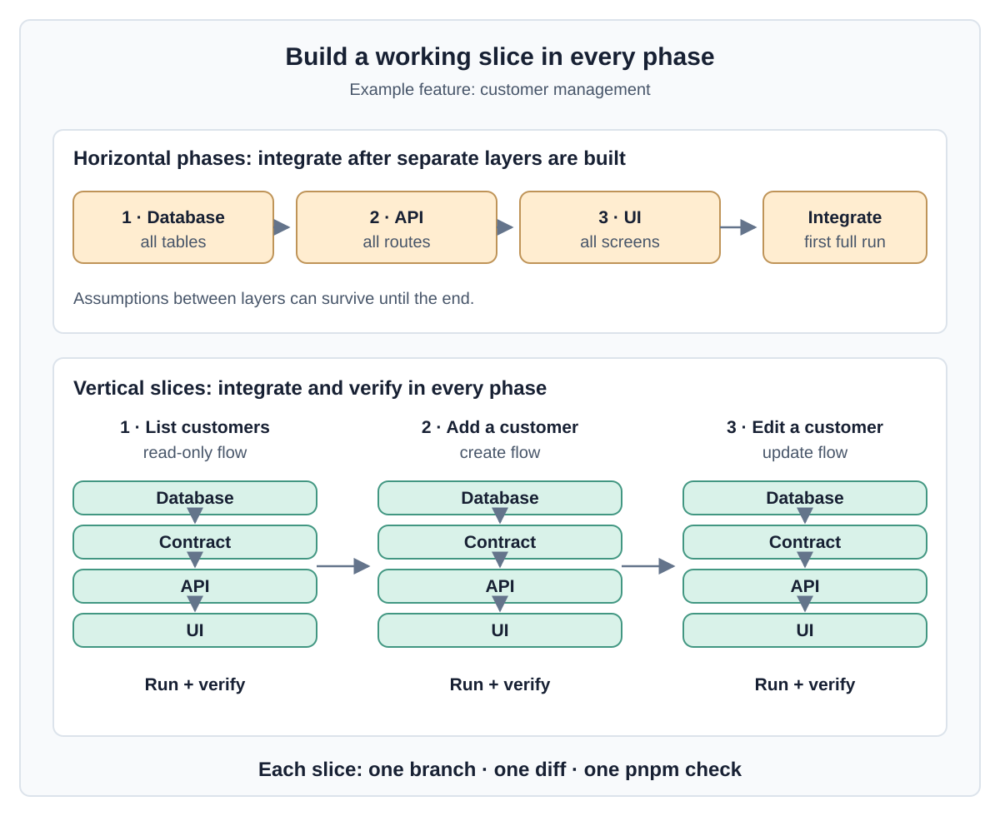

Vertical slices give much better results with an agent:

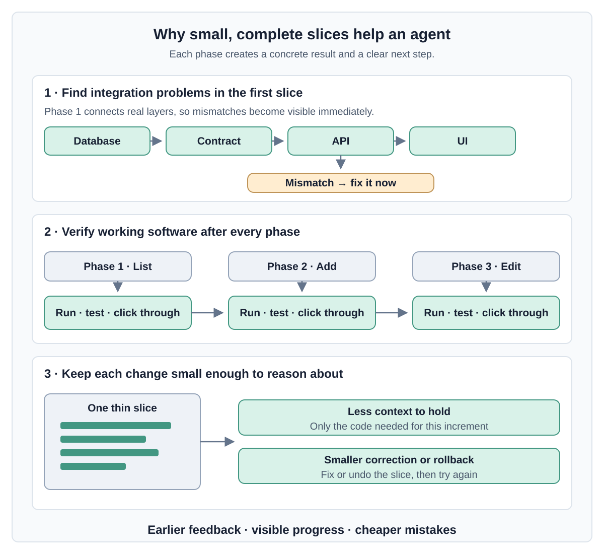

- **Integration problems show up in phase 1, not at the end.** With horizontal phases the agent builds three layers on assumptions, and only finds out they don't fit when everything finally runs together.
- **Every phase can be verified.** After each slice the app runs, the tests pass, and you can click through it. You review working software, not a pile of code you can't run yet.
- **Each phase is small.** The agent keeps less in context, and mistakes are cheap to undo.

**The monorepo is what makes vertical slices practical.** One slice touches the schema, the contract, the API and the UI. Here that is one branch, one diff and one `pnpm check`. In a polyrepo the same slice is three coordinated pull requests plus a publish-and-bump step for the shared contract, so agents (and people) drift back to building one layer at a time.

### 3.3 The compiler reviews the agent's work

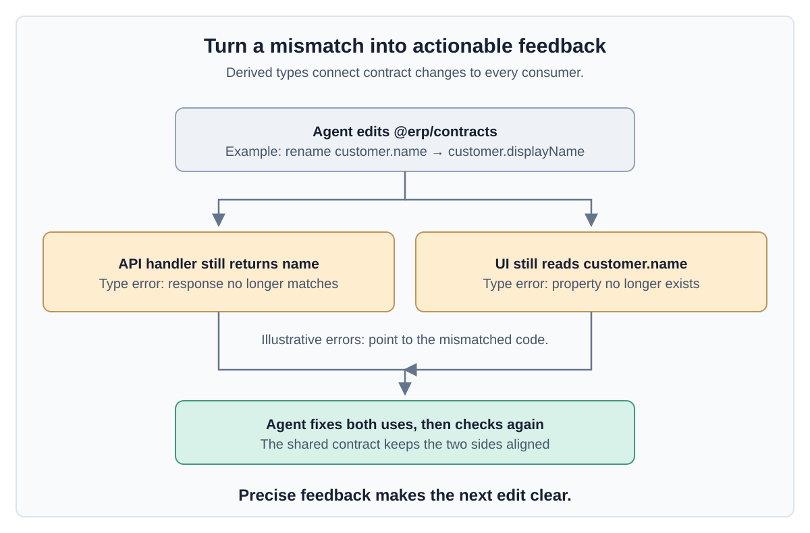

Request and response types are never written by hand in the apps. They are derived from `@erp/contracts`. So if an agent changes the contract, for example by renaming a field, every place in `apps/api` and `apps/web` that no longer matches becomes a **type error**.

This matters because agents are very good at fixing errors they can see, and much weaker at finding mismatches nobody reports. The shared contract turns a silent runtime bug ("the UI shows `undefined`") into a precise compiler message with a file and a line number.

### 3.4 One command to check everything, and it's fast

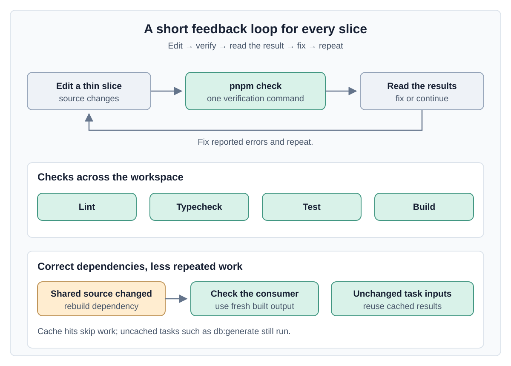

An agent needs one reliable answer to "did I break anything?". Here that is:

```bash
pnpm check   # lint + typecheck + test + build, in every package
```

Turborepo keeps this loop cheap. Packages the agent didn't touch come from the cache, so the agent can run the full check after every slice without waiting for everything to rebuild. For a quicker inner loop it can scope the run with `--filter=@erp/web`.

There is also a subtle correctness benefit. The apps import the **built** output of the shared packages. If an agent edits the contract and then runs `tsc` directly inside `apps/web`, it type-checks against the old build and gets confusing results. Running through Turborepo (`pnpm check`, `pnpm turbo run typecheck`) rebuilds the dependencies first, because of `^build`.

### 3.5 Instructions in layers: shared rules plus per-stack rules

Agents read instruction files: `AGENTS.md`, plus tool-specific files like `CLAUDE.md` or Kiro steering files. In this repo the web app and the API use different stacks, so one flat file would mix React advice with Spring Boot advice. Instead the instructions are layered:

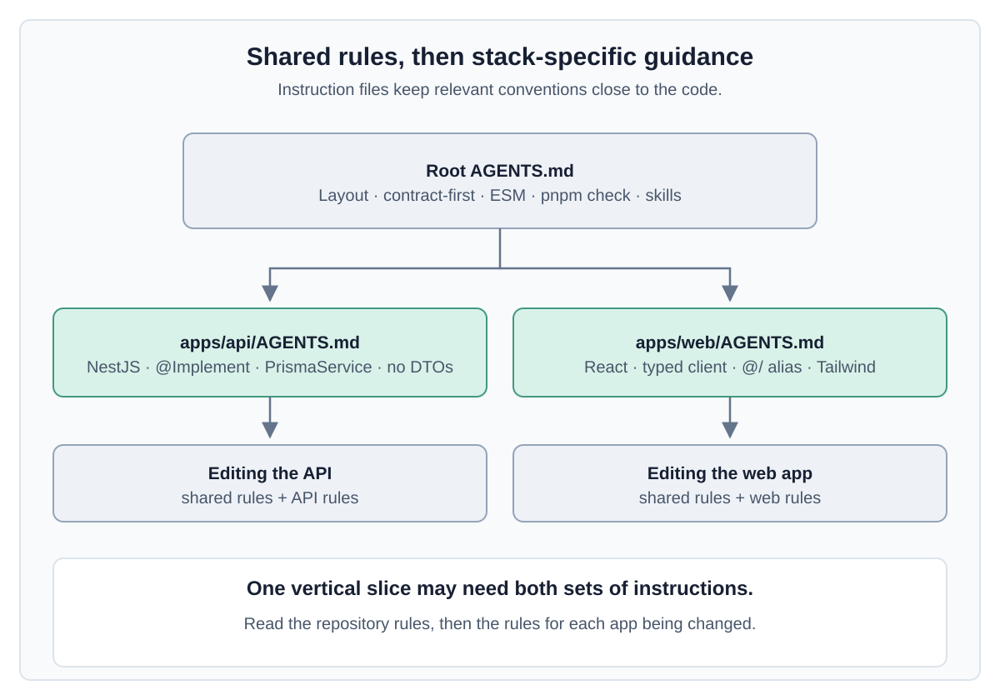

Because the work is done in vertical slices, the agent usually touches both apps in the same phase. It picks up the shared rules plus the rules for each stack it edits.

Each tool finds these files a little differently:

| Tool        | How it finds the per-app rules                                                                                               |
| ----------- | ---------------------------------------------------------------------------------------------------------------------------- |
| Claude Code | Reads `CLAUDE.md`. The root and each app have a one-line `CLAUDE.md` that imports the `AGENTS.md` next to it (`@AGENTS.md`). |
| Codex       | Reads `AGENTS.md` files from the repository root down to the folder it is working in.                                        |
| Cursor      | Applies `AGENTS.md` files from subfolders when working on files inside them.                                                 |
| Kiro        | Uses steering files: `.kiro/steering/project.md` always, `api.md` and `web.md` only for files in their app folder.           |

The root `AGENTS.md` also links to the per-app files, so even a tool that only reads the root knows where to look.

### 3.6 Where it can go wrong

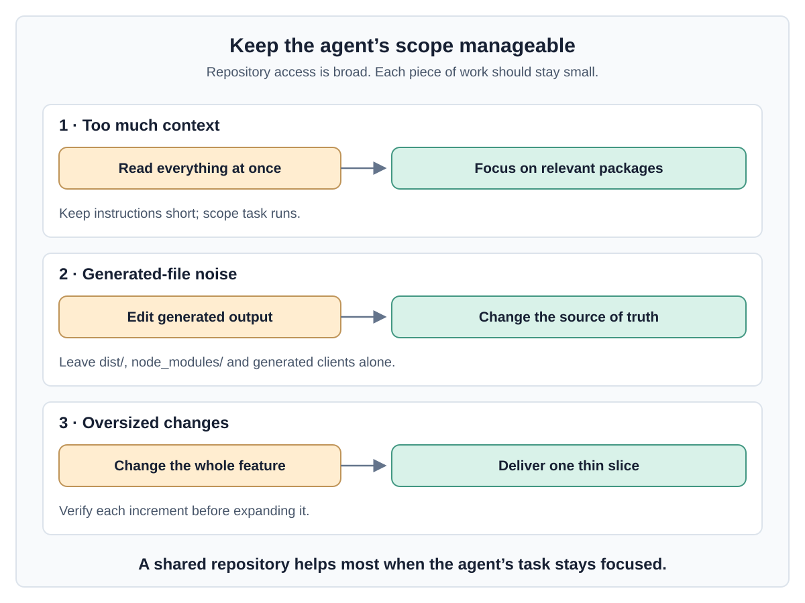

A monorepo isn't automatically good for agents. Watch out for:

- **Context flooding.** A large repo has more than an agent can usefully read. Point it at the relevant packages, keep per-app instructions short, and use `--filter` for narrow tasks.
- **Noise from generated files.** `dist/`, `target/`, `node_modules/` and the generated TypeScript client aren't source code. They're gitignored, and agents should leave them alone.
- **Edits that are too large.** Being able to change everything in one diff doesn't mean every change should. Keep slices thin.

---

## Summary

- A **monorepo** keeps related projects in one repository. Shared code like `@erp/contracts` is used directly, without publishing, and one commit can change every layer.
- **Turborepo** adds a task graph (`dependsOn: ["^build"]`) and caching on top of pnpm workspaces. Checks stay correct and fast as the repo grows, with almost no configuration.
- For **AI coding**, this setup gives the agent:
  - the whole feature in one place
  - vertical slices that fit in one diff
  - type errors as feedback when it breaks the contract
  - one fast command to verify its work
  - layered instructions for each stack

---

## Optional: try it later

This isn't part of the session. If you're curious, run these from the repo root. With Docker, prefix each command with `docker compose exec api`.

```bash
pnpm turbo run build                     # run it twice: the second run is almost entirely cached
pnpm turbo run test --filter=@erp/web    # test one package (its dependencies still build first)
pnpm turbo run build --graph             # print the task graph (Graphviz DOT format)
```
